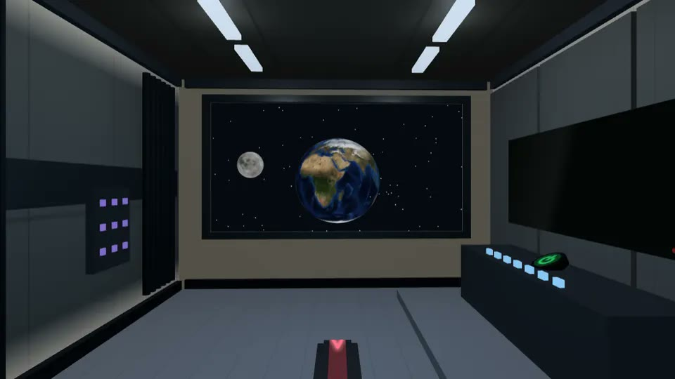
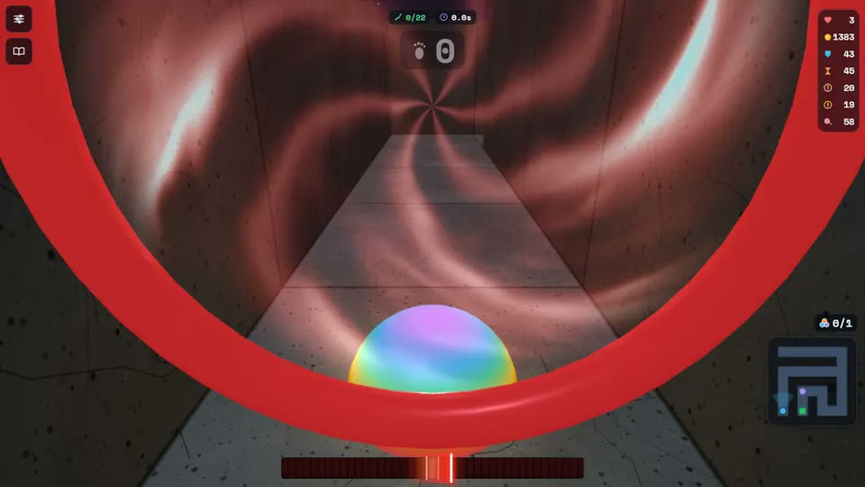
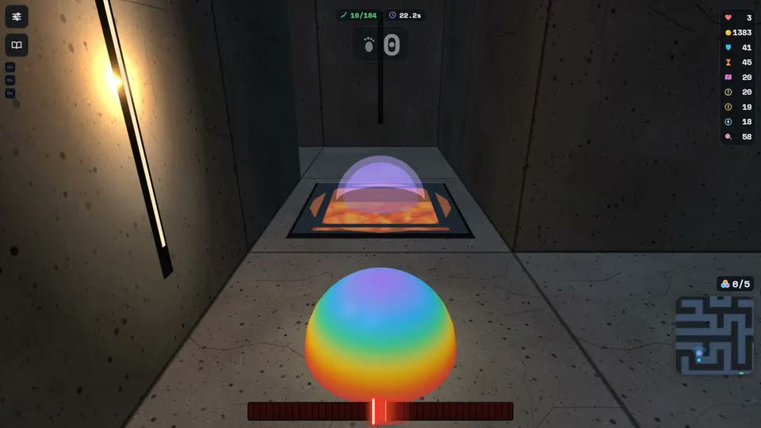
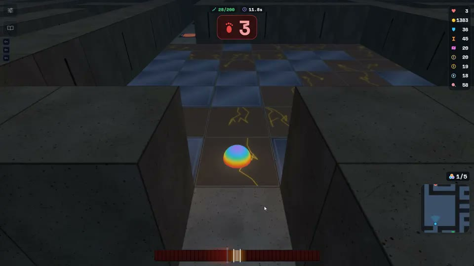

[🇮🇹 Italiano](#-italiano) · [🇬🇧 English](#-english)

# Maze 3D

**Un labirinto 3D a turni a bordo di una nave diretta verso l'ignoto. 90 livelli, gratis, si gioca dal browser.**

▶ **[Gioca ora](https://www.nalimw.it/projects/games/maze/)** · [Scheda del gioco](https://www.nalimw.it/maze-3d) · [English page](https://www.nalimw.it/maze-3d/en) · [itch.io](https://nalimw.itch.io/maze) · [Game Jolt](https://gamejolt.com/games/maze-3d/1101994)

---

## 🇮🇹 Italiano

### Il gioco
Guidi **Sym**, l'intelligenza artificiale di bordo, attraverso mondi-labirinto, mentre **l'Eco** ripercorre i tuoi passi. Si avanza a turni: ogni casella è una scelta.

- **90 livelli** in **9 moduli** e **18 capitoli** di storia, dalla Terra allo spazio fra le stelle
- **Sfida giornaliera** con classifiche e serie di giorni
- Accesso facoltativo con **Google** per ritrovare i progressi su ogni dispositivo
- **Italiano e inglese**
- Niente da scaricare: gira nel browser, da telefono e da PC, e si può **installare come app**

| | |
|---|---|
|  |  |

### Come è fatto
- **TypeScript** in modalità strict, **React** e **Vite**, **Tailwind CSS**
- **Three.js** per il 3D: stanze della nave, mondi-labirinto, cielo con costellazioni e pianeti
- **Phaser 3**
- **Supabase**: accesso con Google, classifiche, sfida giornaliera, controlli anti-imbroglio lato database
- Effetti sonori e musica dei livelli **sintetizzati in tempo reale** con la Web Audio API
- **PWA**: service worker e manifest, installabile su telefono e PC
- Pubblicato su **nalimw.it**, **itch.io** e **Game Jolt**
- Circa **75.000 righe** di TypeScript, **450+ commit** dal 13 agosto 2026

### Chi l'ha fatto e come
Ideazione, game design, storia, test e pubblicazione: **Filippo Cinelli**.
Il codice è stato scritto insieme a **Claude Code** (l'assistente di programmazione con IA di Anthropic): io decido cosa fare e come deve funzionare, l'IA scrive il codice con me e io lo provo, livello per livello.

Il codice sorgente è privato: questo repository presenta il progetto.

### Contatti
- Email: info@nalimw.it
- LinkedIn: [Filippo Cinelli](https://www.linkedin.com/in/filippo-cinelli-3889b776)
- Altri progetti: [nalimw.it](https://www.nalimw.it) · [grinevil.it](https://www.grinevil.it)

---

## 🇬🇧 English

**A turn-based 3D maze aboard a ship bound for the unknown. 90 levels, free, runs in your browser.**

▶ **[Play now](https://www.nalimw.it/projects/games/maze/)** · [Game page](https://www.nalimw.it/maze-3d/en) · [itch.io](https://nalimw.itch.io/maze) · [Game Jolt](https://gamejolt.com/games/maze-3d/1101994)

### The game
You guide **Sym**, the ship's AI, through maze-worlds while **the Echo** retraces your steps. Movement is turn-based: every tile is a choice.

- **90 levels** across **9 modules** and **18 story chapters**, from Earth to interstellar space
- **Daily Challenge** with leaderboards and streaks
- Optional **Google sign-in** to keep your progress on every device
- **English and Italian**
- Nothing to download: it runs in the browser on phone and desktop, and can be **installed as an app**

### How it's built
- **TypeScript** (strict mode), **React** and **Vite**, **Tailwind CSS**
- **Three.js** for the 3D: ship rooms, maze-worlds, a sky with constellations and planets
- **Phaser 3**
- **Supabase**: Google sign-in, leaderboards, Daily Challenge, database-side anti-cheat checks
- Sound effects and level music **synthesized in real time** with the Web Audio API
- **PWA**: service worker and manifest, installable on phone and desktop
- Published on **nalimw.it**, **itch.io** and **Game Jolt**
- About **75,000 lines** of TypeScript, **450+ commits** since August 13, 2026

### Who made it, and how
Concept, game design, story, testing and release: **Filippo Cinelli**.
The code was written together with **Claude Code** (Anthropic's AI coding assistant): I decide what to build and how it should behave, the AI writes the code with me, and I test it level by level.

The source code is private: this repository showcases the project.

### Contact
- Email: info@nalimw.it
- LinkedIn: [Filippo Cinelli](https://www.linkedin.com/in/filippo-cinelli-3889b776)
- Other projects: [nalimw.it](https://www.nalimw.it) · [grinevil.it](https://www.grinevil.it)
